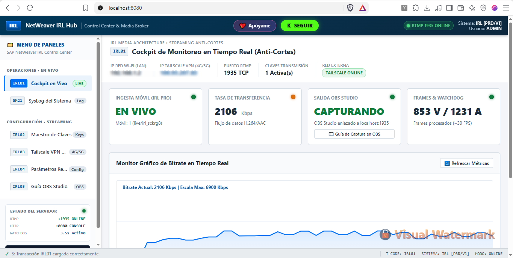

# 📡 IRL High-Availability RTMP Ingestion Server & Automatic OBS Scene Failover Engine
### *Servidor RTMP Anti-Cortes de Alta Disponibilidad & Conmutador Automático de Escenas para Transmisiones IRL*

<div align="center">

[](https://kick.com/iamfreedz)
[](https://www.python.org/)
[](https://obsproject.com/)
[](https://tailscale.com/)
[-0078D6?style=for-the-badge&logo=windows&logoColor=white)](#-descarga-del-ejecutable-standalone-resources)

<br/>

> **💚 Si este proyecto te sirve para tus directos en la calle, ¡apóyame siguiéndome en Kick!**  
> 👉 **[https://kick.com/iamfreedz](https://kick.com/iamfreedz)** 👈

</div>

---

## 📸 Vista Previa del Sistema

<div align="center">
  
  <p><em>Consola de Monitoreo de Transmisión IRL en Tiempo Real (Estilo SAP Fiori / SAP NetWeaver Cockpit)</em></p>
</div>

---

## 📖 Descripción del Proyecto

El mayor problema al realizar transmisiones en vivo en exteriores (**IRL - In Real Life**) a través de redes celulares 4G o 5G es la **inestabilidad de la señal**, las zonas de sombra sin cobertura y los saltos entre antenas móviles. Cuando la conexión se debilita o se corta:
1. La señal se congela en OBS Studio.
2. OBS sigue esperando paquetes y no libera la fuente multimedia.
3. El directo en Kick / Twitch muestra un cuadro congelado o se cae.
4. El streamer pierde minutos valiosos intentando reiniciar la señal manualmente.

**IRL High-Availability RTMP Ingestion Server** resuelve esto implementando una arquitectura de retransmisión local en tu PC de streaming con **Watchdog de desconexión rápida (3.5 segundos)** y un **Plugin Nativo para OBS Studio (Lua & Python)** que conmuta de forma 100% automática a tu escena de **"Volvemos Enseguida / Pausa"** en cuanto la señal celular se pierde, y regresa a tu escena **"En Vivo"** en el instante en que tu celular vuelve a transmitir.

---

## ⚡ Características Principales

* 🚀 **Servidor RTMP Asíncrono de Baja Latencia:** Diseñado sobre `pyrtmp` y `asyncio`, capaz de recibir transmisiones directas en resolución 1080p60 a 6000-8000 Kbps con sobrecarga mínima de CPU.
* 🛡️ **Watchdog de Desconexión Rápida (Anti-Congelamiento):** Corta el socket local en 3.5 segundos si no se reciben paquetes de video/audio, obligando a OBS a detectar el fin de la transmisión sin demoras.
* 🎬 **Plugin Automático para OBS Studio (Lua V2):**
  * Supervisión directa por archivo de estado local de ultra baja latencia (`live_status.txt`).
  * Mecanismo de **cooldown anti-rebote (4 segundos)** para evitar parpadeos intermitentes al reconectar.
  * Inspección dimensional (`width > 0`) para garantizar que el cuadro de video sea válido antes de pasar a la escena principal.
* 💻 **Consola Web de Operaciones (SAP Fiori Style):**
  * Panel empresarial con transacciones SAP: `/nIRL01` (Cockpit), `SM21` (SysLog), `IRL02` (Claves), `IRL03` (Tailscale), `IRL04` (Parámetros) e `IRL05` (Guía OBS).
  * Telemetría en vivo vía WebSockets: Bitrate en tiempo real, FPS, paquetes de audio/video, IP remota, uptime y alertas visuales.
  * Códigos QR generados al instante para escanear y configurar **IRL Pro** o **Larix Broadcaster** en 2 segundos.
* 🔒 **Integración Total con Tailscale VPN:** Transmite de forma encriptada desde cualquier lugar del mundo a través de tus datos móviles 4G/5G sin abrir puertos en tu router ni pagar por IPs públicas.
* 📦 **Versión Standalone (.exe) sin Python:** Disponible en la carpeta `resources/` para usuarios que no tienen Python instalado en su PC.

---

## 🏗️ Arquitectura de Funcionamiento

```text
       [ EN LA CALLE ]                                  [ EN TU PC DE STREAM ]
+----------------------------+                  +-----------------------------------+
|  Celular Móvil (4G / 5G)   |                  |       Tailscale VPN Client        |
|  App: IRL Pro / Larix      | ====(Mesh VPN)==>|       (IP Privada 100.x.x.x)      |
+----------------------------+                  +-----------------+-----------------+
                                                                  |
                                                                  v
                                                +-----------------+-----------------+
                                                |     Servidor RTMP Anti-Cortes     |
                                                |  (Puerto 1935 | Watchdog: 3.5s)   |
                                                +--------+------------------+-------+
                                                         |                  |
                                       Telemetría WS /   |                  | Loopback Local
                                       Estado de Señal   |                  | rtmp://127.0.0.1:1935/live
                                                         v                  v
                                                +--------+-------+  +-------+-------+
                                                |  Consola Web   |  |  OBS Studio   |
                                                | (Puerto 8080)  |  | Media Source  |
                                                +----------------+  +-------+-------+
                                                                            |
                                                                   Script Lua Switcher
                                                                            v
                                                                 Cambio de Escena Automático:
                                                                 🟢 Señal OK -> EN VIVO
                                                                 🔴 Sin Señal -> PAUSA
```

---

## 📦 Descarga del Ejecutable Standalone (resources/)

Si **no tienes Python instalado**, puedes usar directamente la versión precompilada:

1. Ve a la carpeta **[`resources/`](resources/)** del repositorio.
2. Descarga o ejecuta el archivo **`IRL_Server.exe`**.
3. **¿Qué hace automáticamente al abrirse?**
   * Extrae la carpeta `obs_plugin/` con los scripts de OBS Studio listos para usar.
   * Crea un acceso directo en tu Escritorio: `IRL Stream Server`.
   * Inicia el servidor RTMP (puerto `1935`) y la Consola Web (puerto `8080`).
   * Abre automáticamente la consola en tu navegador: `http://localhost:8080`.

---

## 🛠️ Instalación desde Código Fuente (Para Desarrolladores)

### Requisitos Previos
* Windows 10 u 11 (64-bit).
* Python 3.10, 3.11 o 3.12 instalado.
* OBS Studio 28 o superior.

### Pasos de Instalación
```bash
# 1. Clonar el repositorio
git clone https://github.com/iamfreedz/irl-stream-server.git
cd irl-stream-server

# 2. Crear y activar un entorno virtual (recomendado)
python -m venv venv
venv\Scripts\activate

# 3. Instalar dependencias requeridas
pip install -r requirements.txt

# 4. Iniciar el servidor
python rtmp_server.py
# (O haz doble clic en start_server.bat)
```

---

## 📋 Guía Detallada de Configuración Paso a Paso

### 🔹 Paso 1: Configurar Tailscale VPN (Para la calle 4G/5G)
1. Instala **[Tailscale](https://tailscale.com/)** en tu PC de streaming y en tu celular móvil.
2. Inicia sesión con la **misma cuenta** en ambos dispositivos (por ejemplo, tu cuenta de Google).
3. En la PC, abre Tailscale y copia tu dirección IP privada (comienza con `100.x.x.x`).
4. Abre la consola web del servidor en `http://localhost:8080` y ve a la transacción **`[IRL03] Tailscale VPN Móvil`**; el sistema detectará tu IP automáticamente.

---

### 🔹 Paso 2: Configurar tu Celular Móvil (IRL Pro / Larix Broadcaster)
1. Abre **IRL Pro** o **Larix Broadcaster** en tu teléfono.
2. Activa Tailscale en tu celular (interruptor de encendido conectado).
3. En la app de cámara:
   * **URL del Servidor / Host:** `rtmp://TU_IP_TAILSCALE:1935/live` *(ej: `rtmp://100.93.207.83:1935/live`)*
   * **Stream Key (Clave):** `irl` *(o la clave que configuraste en `[IRL02]`)*
   * *(O simplemente escanea el código QR desde la consola web)*.
4. Pulsa el botón de transmitir en tu celular.

---

### 🔹 Paso 3: Configurar OBS Studio (Fuente Multimedia Loopback)
1. En OBS Studio, ve a tu escena principal de directos (por ejemplo: `EN VIVO`).
2. En el panel **Fuentes (Sources)**, haz clic en **+** y selecciona **Fuente multimedia** (Media Source).
3. Nómbrala `Móvil IRL - Directo`.
4. Configura las siguientes casillas con **estricta atención**:
   * ❌ **Desmarcar:** `Archivo local` (Local file).
   * 📝 **Entrada (Input):** `rtmp://127.0.0.1:1935/live/irl`
   * 📝 **Formato de entrada:** Déjalo vacío.
   * ❌ **DESMARCAR OBLIGATORIAMENTE:** `Reiniciar la reproducción cuando la fuente esté activa`.
   * ❌ **DESMARCAR OBLIGATORIAMENTE:** `Cerrar el archivo cuando esté inactivo`.
   * ⚙️ **Comportamiento de la visibilidad:** Selecciona *"Detener cuando no sea visible, reanudar cuando sea visible"*.
   * ⏱️ **Almacenamiento en búfer de red:** Ajusta a `300` o `500` ms.
5. Pulsa **Aceptar**.

---

### 🔹 Paso 4: Cargar el Conmutador de Escenas Automático en OBS Studio
1. En OBS Studio, dirígete al menú superior: **Herramientas (Tools) ➔ Scripts**.
2. En la pestaña **Scripts**, pulsa el botón **+** (esquina inferior izquierda).
3. Entra en la carpeta **`obs_plugin`** de este proyecto y selecciona:
   * **`irl_auto_scene_switcher.lua`** *(Recomendado: Máxima estabilidad, no requiere runtime adicional)*.
4. En el panel derecho de configuración del script:
   * **Fuente Multimedia a Monitorear:** Selecciona `Móvil IRL - Directo`.
   * **Escena cuando haya Video (EN VIVO):** Selecciona tu escena de cámara en vivo (ej: `EN VIVO`).
   * **Escena cuando se Corte (PAUSA):** Selecciona tu escena de corte o espera (ej: `PAUSA / VOLVEMOS`).
   * **Intervalo de Chequeo:** `250` ms.
   * **Tiempo de Enfriamiento:** `4.0` s.
5. Haz una prueba apagando el Wi-Fi o cortando la señal en tu móvil: OBS cambiará inmediatamente a tu pantalla de Pausa. En cuanto vuelvas a conectar, regresará a tu escena en vivo.

---

### 🔹 Paso 5: Monitoreo en la Consola Web (SAP Fiori Cockpit)
Abre tu navegador en `http://localhost:8080`. Dispones de las siguientes vistas:

| Transacción | Nombre | Propósito |
| :---: | :--- | :--- |
| **`[IRL01]`** | **Cockpit en Vivo** | Gráfica de bitrate en tiempo real, FPS, paquetes transmitidos y alertas de watchdog. |
| **`[SM21]`** | **SysLog del Sistema** | Registro de auditoría de conexiones RTMP, desconexiones y eventos de socket. |
| **`[IRL02]`** | **Maestro de Claves** | Gestión de múltiples claves de transmisión con códigos QR instantáneos. |
| **`[IRL03]`** | **Tailscale VPN Móvil** | Detección de IP VPN y generador de enlaces de ingesta rápida para la calle. |
| **`[IRL04]`** | **Parámetros Red & IP** | Ajuste fino del timeout del watchdog, puertos de red y modo de URL. |
| **`[IRL05]`** | **Guía OBS Studio** | Instrucciones interactivas con listas de verificación de opciones para OBS. |

---

## 💖 Apóyame en Kick

Este sistema fue desarrollado con mucho cariño para la comunidad hispanohablante de streamers IRL que sufren de cortes de señal y pantallas congeladas.

Si este proyecto te ha servido o te ha salvado un directo en la calle:
* 🟢 **Sígueme en Kick:** **[https://kick.com/iamfreedz](https://kick.com/iamfreedz)**
* ⭐ **Deja una estrella en este repositorio de GitHub** para ayudar a que más streamers lo encuentren.

---

## 📄 Licencia

Este proyecto está bajo la Licencia **MIT**. Eres libre de usarlo, modificarlo y compartirlo en tus transmisiones personales o profesionales.
